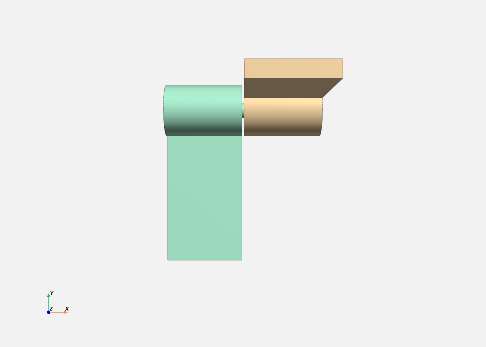

# cadstudio

Parametric CAD in Python, with the feedback loop built in. You describe a part with [build123d](https://github.com/gumyr/build123d) (an OpenCascade B-rep kernel), and `cadstudio` exports STEP, STL and 3MF, runs printability checks, renders views, runs optional MuJoCo physics sims, and shows it all live in a VS Code panel. It is built so that agents like Claude Code and Codex can drive it: every command has a `--json` mode, every build writes a report and renders an agent can read, and the repo ships the instructions and skills they need.



## Requirements

- macOS on Apple silicon (the physics wheel is arm64 only)
- [Homebrew](https://brew.sh)
- [VS Code](https://code.visualstudio.com) recommended, for the live viewer panel

## Install

```
git clone https://github.com/danillogical/cadstudio.git cadstudio
cd cadstudio
./setup.sh
```

`setup.sh` is safe to re-run. It installs `uv` and `node` (22 or newer) with Homebrew if they are missing, syncs the Python environment, builds the UI and the VS Code extension, installs the extension if the `code` command is available, and finishes with `cad doctor`. It can also offer PrusaSlicer. See `./setup.sh --help` for `--yes`, `--no-prusaslicer` and `--workspace`.

## 5-minute quickstart

The repo ships a small example project, `starter`, with two models.

```
uv run cad list
uv run cad build starter/hinge --check --render --views standard
```

`cad list` prints every model as `<project>/<model>`. The build writes to `projects/starter/out/hinge/`:

- `report.md` and `report.json`: the check table (valid solid, watertight, bed fit, minimum wall, clearance, overhangs, mass).
- `renders/*.png`: `iso`, `front`, `back`, `top`, and a print-pose image per part.
- `assembly.step`, plus `.step`, `.stl` and `.3mf` per part (`leaf_a`, `leaf_b`), ready for a slicer.

Open it in the viewer:

```
uv run cad gui open starter/hinge
```

Everything is driven from `projects/starter/params.toml`. Override a value for one run with `--set`:

```
uv run cad build starter/hinge --check --set hinge.open_deg=45
```

Use `--views standard` while iterating (the default, `all`, is slow). Add `--json` to `list`, `build`, `gui scene` or `doctor` for one machine-readable document on stdout, with progress on stderr.

## Your own projects

A project is a package `projects/<name>/` with a `params.toml`, a `params.py`, and a `models/` package whose modules each expose `build(p)`. Copy `projects/starter/` as a template.

Two ways to keep your projects:

- **In this repo**, under `projects/`. Simple, but it mixes your work with the engine.
- **In your own repo (recommended).** Create `projects/<name>/` there, plus a `pyproject.toml` that depends on the engine by path:

  ```toml
  [project]
  name = "my-projects"
  requires-python = ">=3.11,<3.14"
  dependencies = ["cadstudio"]

  [project.optional-dependencies]
  physics = ["cadstudio[physics]"]

  [tool.uv]
  package = false

  [tool.uv.sources]
  cadstudio = { path = "../cadstudio", editable = true }
  ```

  Then, from the engine checkout:

  ```
  ./setup.sh --workspace ../my-projects
  ```

  This runs `uv sync` in your repo and links the engine's agent skills into it. Run `cad` from inside your repo: the nearest ancestor directory containing `projects/` is the workspace (or set `CADSTUDIO_WORKSPACE`), and outputs go to `<workspace>/projects/<project>/out/`.

## Live monitoring

Open the panel once, then keep working in the terminal:

```
uv run --frozen --extra physics cad gui open starter/hinge
```

Keep **Follow** on in the panel (it is on by default). While it is on, edits to the shown model's sources under `projects/<project>/` rebuild that model in the service, and the panel picks up the new scene. A `cad physics run` appears as a live run: its poses stream into the panel while it steps, and when it finishes the panel swaps to the final trajectory and loops it. The panel has separate Project and Model selectors; the runs list shows the selected model's runs.

Scene writes and new runs under `projects/<project>/out/` are shown whatever started them, so an agent's builds and sims show up in the panel too. Pass `--no-live` to `cad physics run` to skip the live stream; the finished run is still written. If the panel closes, the service drops the follow 60 s after its last renewal.

## Physics (optional)

Rigid-body physics uses MuJoCo and is an optional extra; the CAD commands never import it. `setup.sh` installs it. To check it works:

```
uv run --frozen --extra physics cad physics smoke
```

`cad physics smoke` drops a 20 mm box 100 mm onto a fixed floor and checks the free fall, contact time, rest height, mass and inertia against analytic values. Exit codes: `0` PASS, `1` FAIL, `2` INCONCLUSIVE, `3` ERROR. Real runs use `cad physics run <model> --scenario S --acceptance A`; see `cad physics --help`.

## Using with Claude Code or Codex

Open the repo (or your projects repo, after `./setup.sh --workspace`) in Claude Code or Codex. `AGENTS.md` / `CLAUDE.md` and the skills in `.claude/skills/` and `.agents/skills/` load automatically, so the agent already knows the build loop, the checks and how to open the viewer. Try:

- "Build starter/box with checks and renders, then tell me which checks warn and why."
- "Make the hinge knuckles 20% longer, rebuild, and show it to me in the viewer."
- "Add a lid model to the starter project that fits starter/box with 0.3 mm clearance, and check it."
- "Open starter/hinge in CADStudio."

Agents should read `report.md` and at least one render before claiming a geometry change works.

## Troubleshooting

- **Start with `uv run cad doctor`.** It reports Python, uv, build123d, MuJoCo, node/npm, the output directory and the UI and extension builds.
- **`code` command missing.** In VS Code, run `Shell Command: Install 'code' command in PATH` from the Command Palette, then re-run `./setup.sh`.
- **Local health checks lie inside a sandbox.** Some agent sandboxes route loopback HTTP through a proxy that answers `200` for a dead server. Check that the GUI service is up with `lsof -nP -iTCP:<port> -sTCP:LISTEN` (the port is in `.cadstudio/gui/service.json`) rather than trusting an HTTP status.
- **MuJoCo will not install.** The wheel is arm64 macOS only. On Intel Macs or other platforms, skip physics; CAD commands still work.
- **Node too old.** The UI and extension need node 22 or newer: `brew upgrade node`.
- **`prusa-slicer` not found.** Projects that slice from the command line need it on `PATH`; `./setup.sh` offers to install PrusaSlicer and link it into `~/.local/bin`.

## Project layout

```
cadkit/            the engine: params, export, render, checks, physics, CLI, GUI service
projects/starter/  the bundled example project (starter/box, starter/hinge)
projects/*/out/    model outputs and physics runs (gitignored)
.cadstudio/        GUI service record and log, engine fixture runs (gitignored)
ui/                the Three.js viewer
editor/vscode/     the VS Code extension that hosts the viewer
tests/             pytest suite (about 3.5 minutes): uv run pytest tests -q
setup.sh           one-shot installer
```
