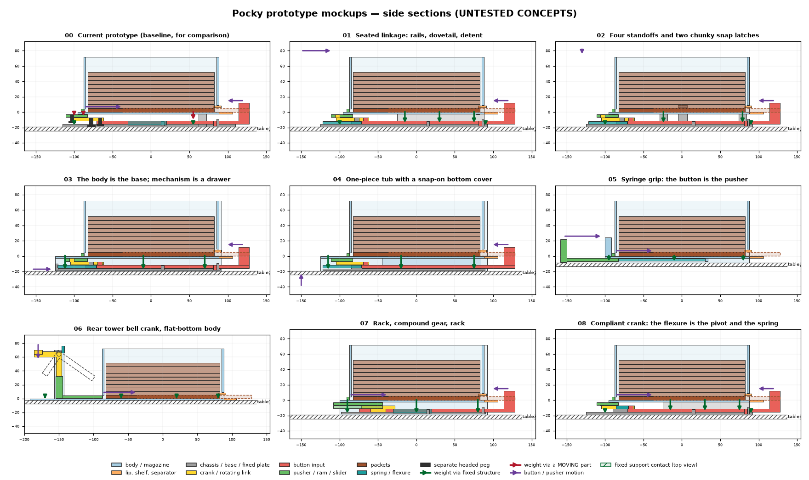
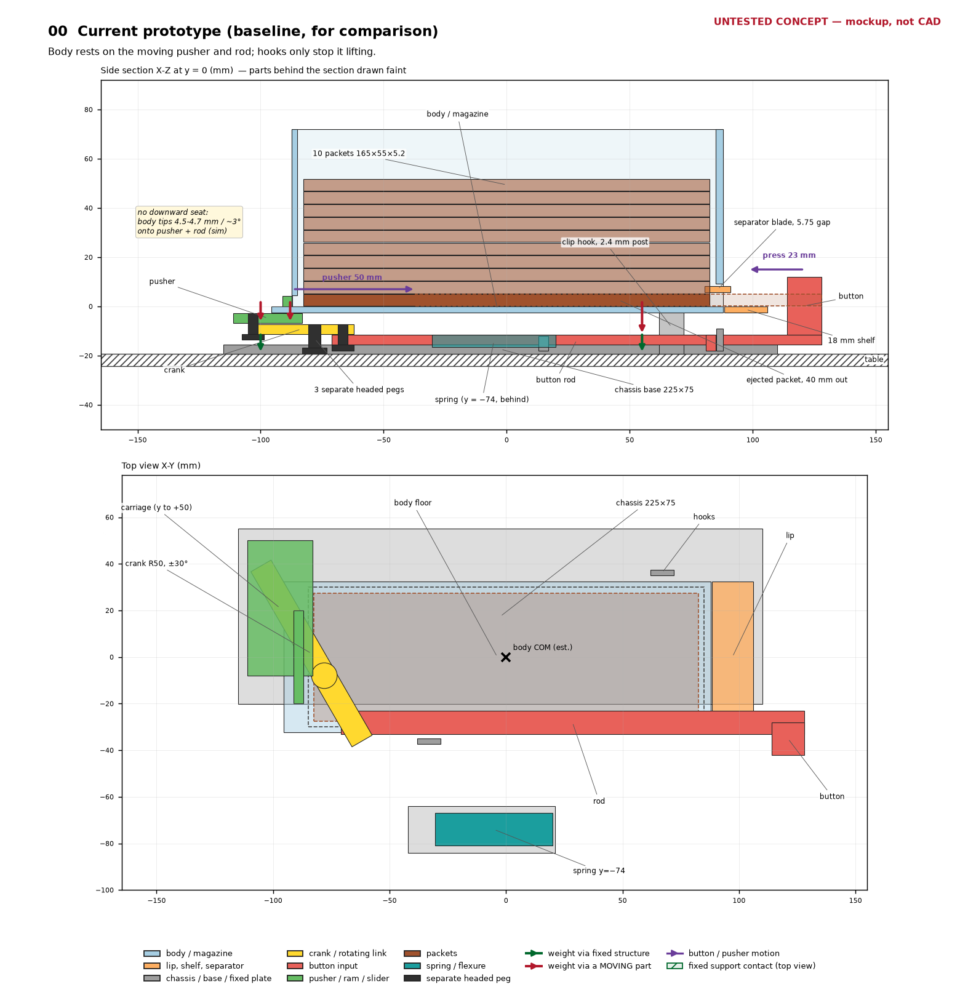
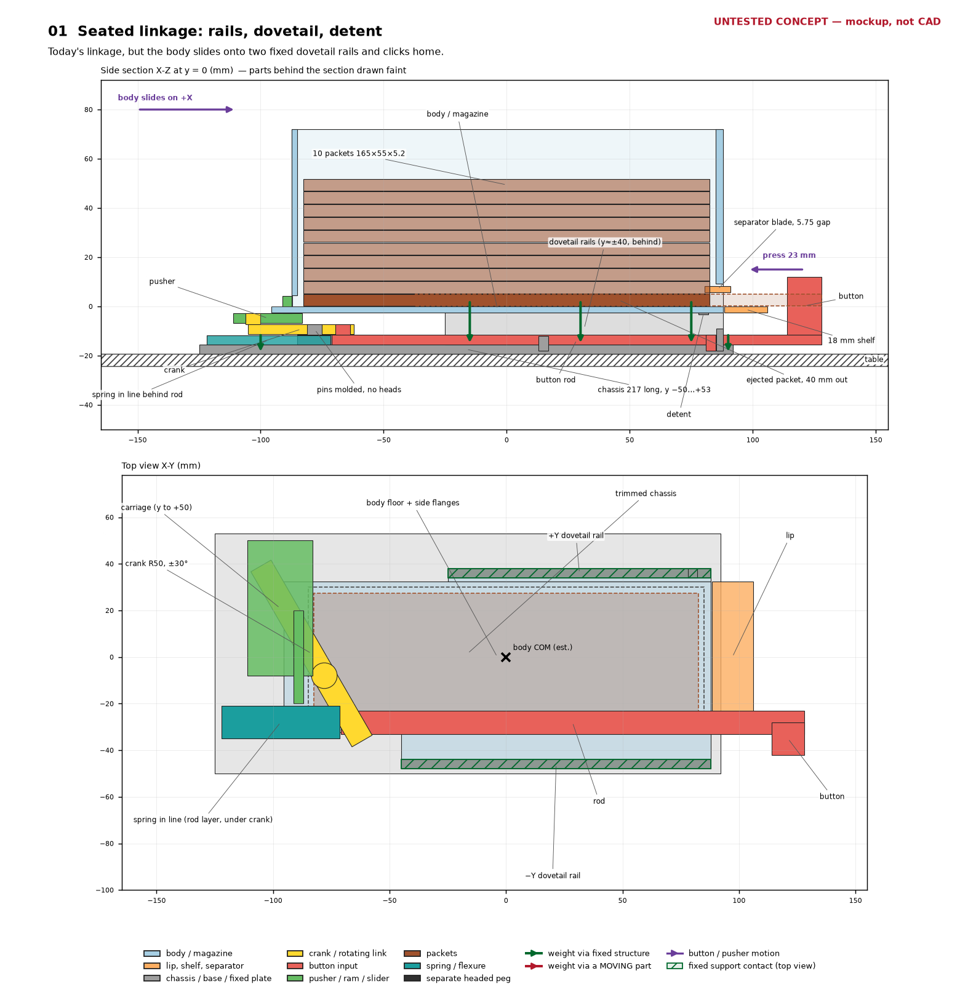
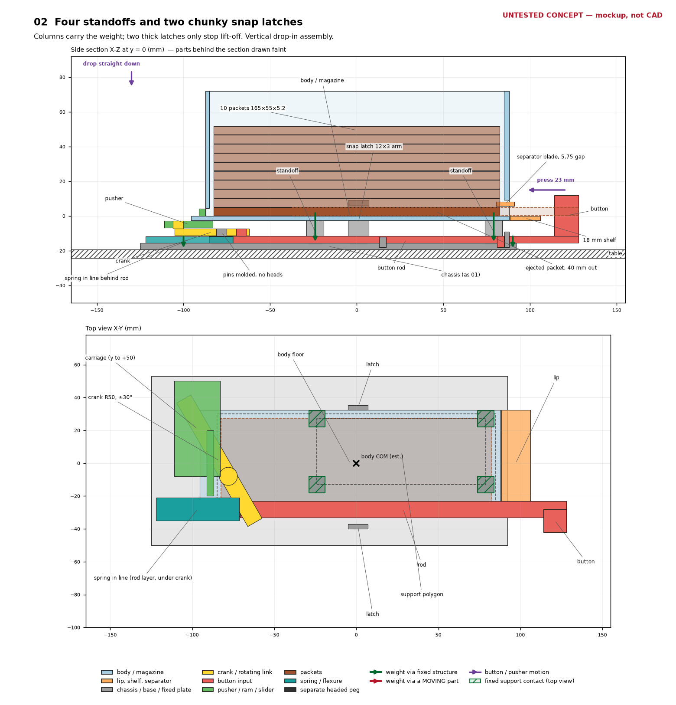
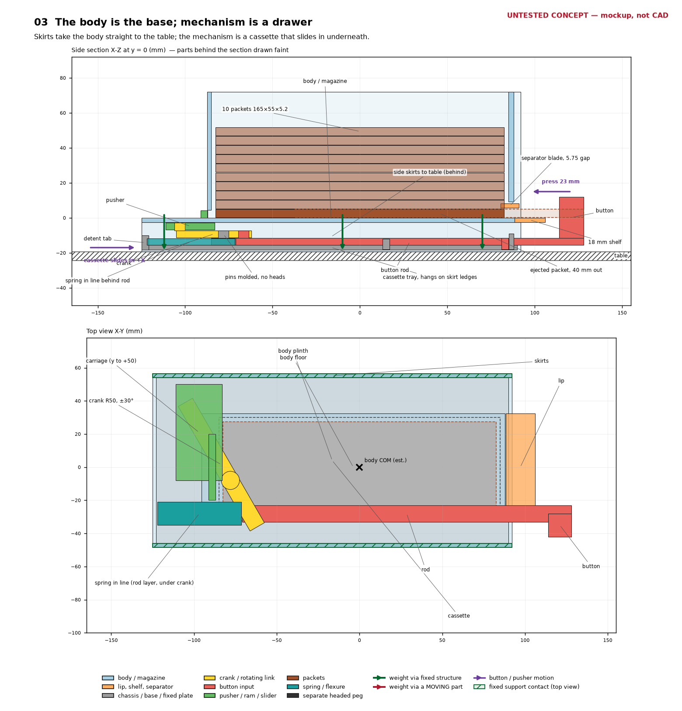
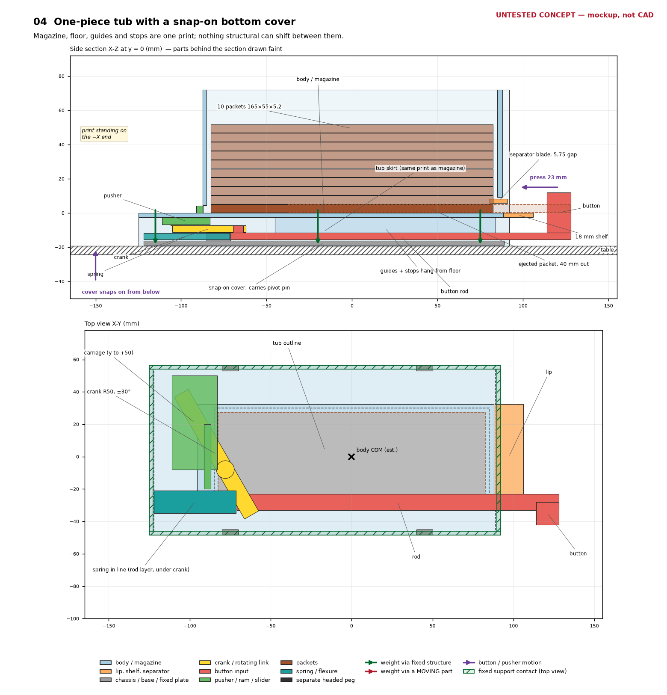
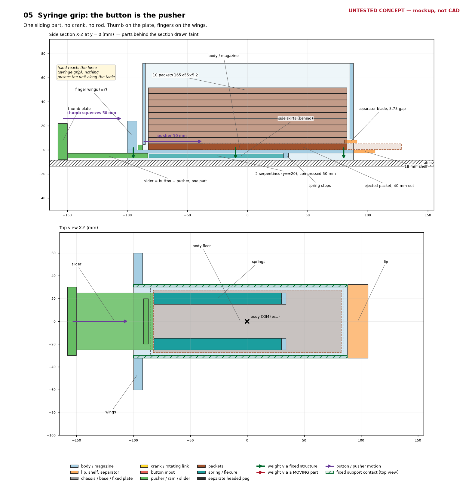
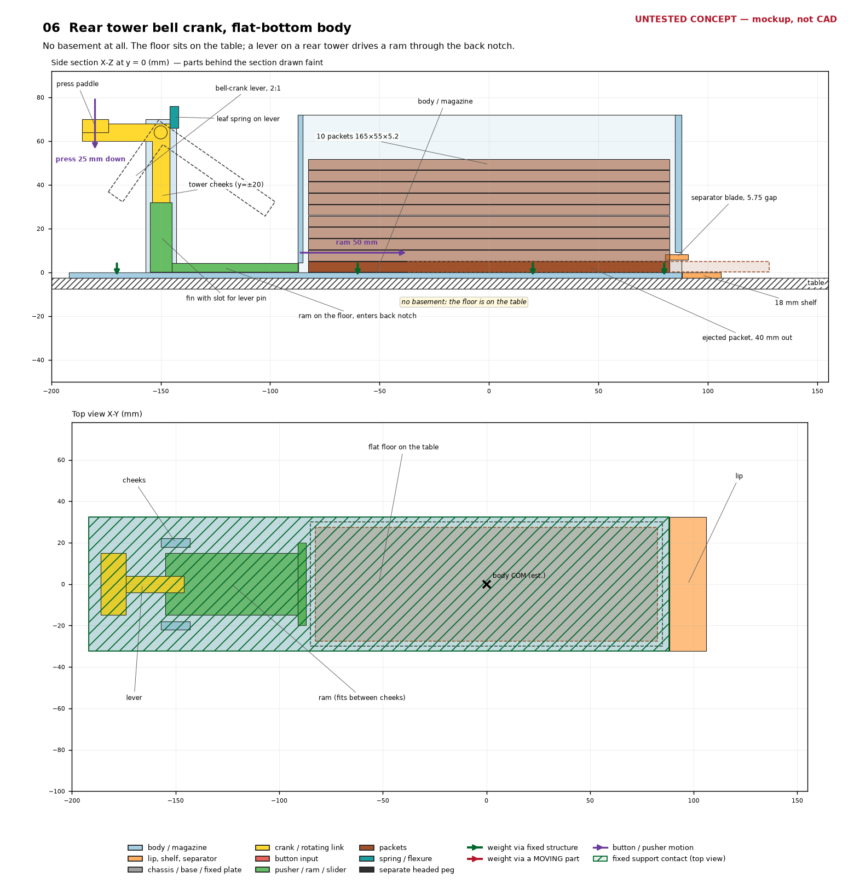
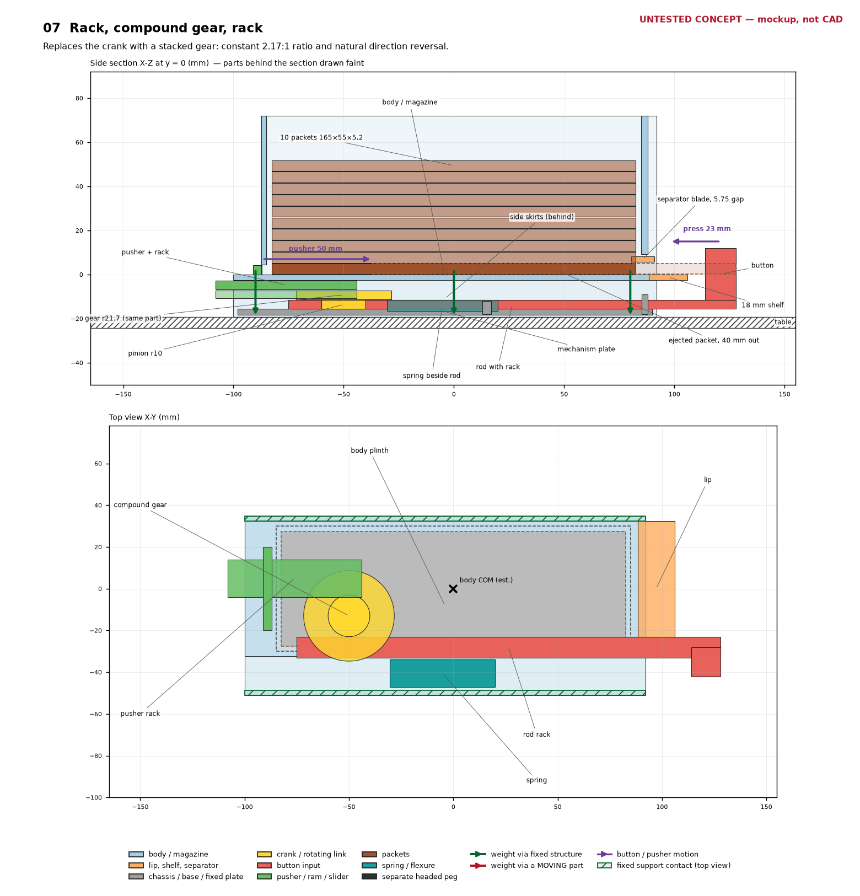
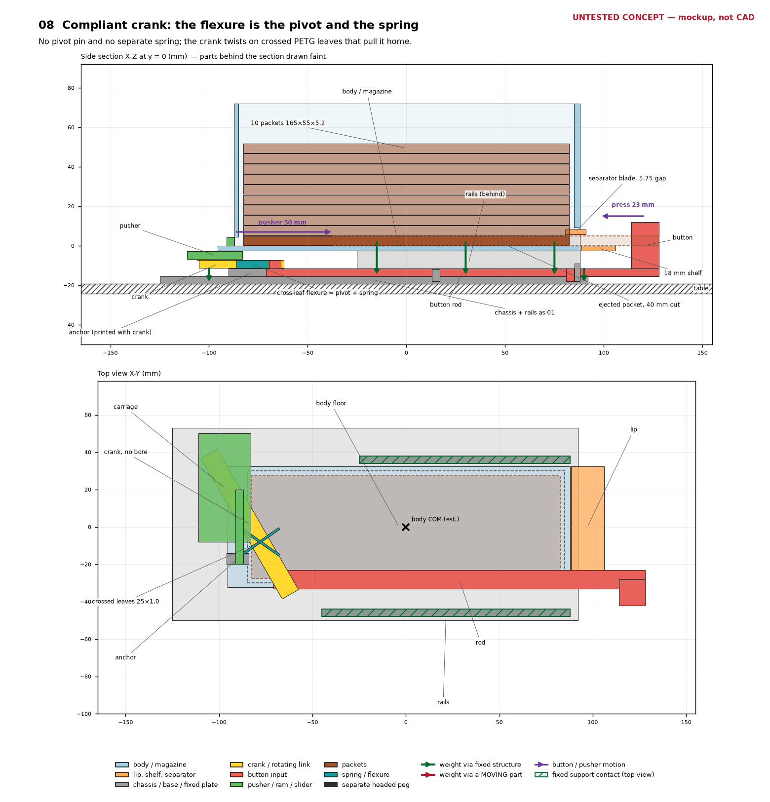

# Pocky prototype mockups

> **Every concept on this page is untested.** These are sketches for discussion, not CAD. None has been modelled, simulated or printed. Dimensions reused from the current prototype come from `projects/pocky/geometry/linkage.py` and `projects/pocky/geometry/prototype.py`. Everything new (rails, skirts, latches, gears, levers, flexures) is a first guess, drawn roughly to scale.

The images are generated by `sketch.py` in this folder:

```
uv run --frozen python projects/pocky/docs/mockups/sketch.py
```

Each image has a side section (X–Z at y = 0) above a top view (X–Y). Colours are the same in every image: housing light blue, lip orange, chassis/base grey, crank or any rotating link yellow, button input red, pusher green, packets brown, spring teal. Thick dark-green arrows show the body's weight going to the table through fixed structure. Thick dark-red arrows show weight carried by a moving part. Purple arrows show the button and pusher motion. Green hatching in the top view marks where fixed supports touch the body. The "body COM (est.)" cross is placed at x = 0, y = 0. That is a guess from the body being nearly symmetric in X; it has not been computed.



## What failed, and why

These findings come from the validated MuJoCo runs (`docs/mujoco-sim-valid-report.md`, `out/mujoco-dispense/verdict.md`) and from the user's print.

- **The body has no downward seat.** The chassis (`projects/pocky/geometry/prototype.py:534`) holds it with two clip hooks (`prototype.py:631`). Each hook is a 1 mm tooth sitting 0.05 mm above a body rib, on a 2.4 mm post. The hooks only stop the body lifting, and they are fragile.
- **The body falls onto the mechanism.** The bearing strip is 4.2 mm wide, and the body's COM is 4.5 mm outside it. In the valid S0 runs the body drops 4.47–4.66 mm and rotates about 3°, and comes to rest on the pusher carriage and the rod. In the dispense run, `body_on_pusher` lasts 3.1 s with a peak force of 60 N, and `body_on_rod` lasts 3.0 s with a peak of 31 N. The print does the same thing: "the body is sitting on pegs, the body falls down when you press the button".
- **The packet jams.** When a packet is loaded, the sagging lip and blade clamp it. The pusher jams after about 5 mm, and the dispense-run summary has the button stalling at about 29% of its stroke. The packet crosses the exit plane by only 1.4 µm, and presentation fails with `support_lost`.
- **The pegs are left over from steel pins.** The pivot, pusher and button pegs are separate printed pins with heads. That made sense with steel dowels. In the Z stack (bottom to top) the order is chassis base −19.2…−15.6, rod −15.6…−11.6, crank −11.2…−7.2, carriage −6.8…−2.8, then body floor −2.4…0, with 0.4 mm gaps between layers. Once the body floor is properly seated it caps the whole stack. Each pin can then be molded onto the part below it with no head: 5–6 mm pins with root fillets, for layer-shear strength.
- **The chassis is oversized.** The base is 225 × 75 mm (`prototype.py:539`), and the spring pocket sticks out to y ≈ −84. The body footprint is about 184 × 65.

Geometry facts that limit any concept that keeps the crank. Each one comes from `linkage.py` and is visible in the top views:

- The pusher carriage spans y −8…+50, and the crank's pusher pin travels at y ≈ 35–42. Both are outside the body's ±32.4 mm side walls.
- The crank and carriage together sweep the rear ~70 mm under the body (x ≈ −111…−33), so there is nowhere to put a support under the rear corners.
- Fixed supports can therefore only sit at x ≥ −25 (on +Y) and x ≥ −45 (on −Y). That still leaves the estimated COM about 20–25 mm inside the support polygon. A wider seat would need the crank moved, and Gate A says not to move it.

### Fixed requirements (every concept)

- One rigid 165 × 55 × 5.2 mm packet per press.
- A stack of about 10 packets, fed by gravity.
- A 5.75 mm separator gap under the blade, so only one packet goes.
- After the button is released, the packet protrudes at least 30 mm past the exit face and at least 10 mm past the 18 mm shelf, and stays supported there.
- Spring return.
- All PETG, all printed, hand-assembled. No screws, inserts or metal.

## Comparison

Part counts include the lip and one shim, but not the spare shim or the dummy packets. "Footprint" is the overall X × Y of the fixed parts, without the lip.

| # | Concept | Parts | How the body is supported | Pegs / fasteners | Mechanism | Printability | Main risk |
|---|---|---:|---|---|---|---|---|
| 00 | Current (baseline) | 12 | Not supported downward; rests on the pusher and rod | 3 separate headed pegs, 2 clip hooks | M1 crank, 23 mm button, 50 mm push | Good | Already fails S0 and dispense |
| 01 | Rails + dovetail + detent | 9 | Two fixed dovetail rails under side flanges | Molded pins; dovetail and detent | M1 crank, unchanged | Good; dovetail needs tuning | Rails can't reach the rear (crank sweep) |
| 02 | Standoffs + snap latches | 9 | Four columns from the chassis base to the floor | Molded pins; 2 thick latches | M1 crank, unchanged | Good | Latch fatigue; columns must miss the sweep |
| 03 | Body is the base, mechanism drawer | 9 | Body skirts straight to the table | Molded pins; drawer detent | M1 crank, in a cassette | Good; wide floor | Drawer slop in Z sets the gaps |
| 04 | One-piece tub + bottom cover | 8 | Tub rim straight to the table | Molded pins; 4 cover clips | M1 crank, installed from below | Tall print on its end | Tub print time and warp; tall-print wobble |
| 05 | Syringe direct slider | 6 | Body skirts straight to the table | One molded neck; no pins | One slider, 50 mm thumb stroke | Very good | 50 mm spring travel; user ergonomics |
| 06 | Rear tower bell crank | 5 | Flat floor straight on the table | Molded axle in snap bearings; 1 molded slot pin | Lever 2:1 + ram through the back notch | Good; tower is tall | Ram guidance; lever pivot wear |
| 07 | Rack, compound gear, rack | 8 | Body skirts straight to the table | Molded gear axle | Gear reverser, constant 2.19:1 | Gears need 0.2 mm layers | Tooth strength and backlash in PETG |
| 08 | Compliant crank | 7 | As 01 (rails) | No pivot pin; 2 molded slot pins | M1 crank on a crossed-leaf flexure | Good; leaves printed flat | Flexure fatigue and creep |

---

## 00 — Current prototype (baseline, for comparison)



This is not a concept. It is drawn so the others can be compared with it. The red arrows show what the sim found. The body's weight goes into the pusher carriage and the rod, which are moving parts, and only then into the chassis. The clip hooks (grey posts) resist lift-off only. The spring pocket at y = −74 sets most of the footprint's Y extent.

---

## 01 — Seated linkage: rails, dovetail, detent



**What stands out.** This is the smallest change that directly fixes the S0 failure. The M1 linkage is kept exactly (Gate A untouched). The body gains two side flanges that slide onto two fixed dovetail rails on the chassis and click home on a detent. The floor slot is opened through the back edge, so as the body slides on in +X the pusher neck enters the slot and the bullnose enters the back-wall notch. The pegs become headless pins molded on the part below, and the spring moves in line behind the rod tail, which removes the y = −74 pocket.

- **Weight path.** Body → flanges → dovetail rails (x −25…+88 on +Y, x −45…+88 on −Y) → chassis base → table. Every link is fixed. The rails stop where the crank and carriage sweep, and the estimated COM is still about 20–25 mm inside the rear edge of the support polygon.
- **Dispensing.** Unchanged from today. The 23 mm button press turns the crank and moves the pusher 50 mm. The packet leaves under the 5.75 mm blade and parks 40 mm out on the shelf.
- **Pegs/fasteners.** Each pin is molded on the part below it. The pivot pin is on the chassis boss, the button pin on the rod, the pusher pin on the crank. All are Ø5–6 with root fillets, and the seated floor caps the stack. Growing the pins from Ø4 to Ø5 means slots of about 5.6 mm, so the crank arm needs to widen from 10 to about 11 mm to keep 2.4 mm walls. The dovetail rails and one detent replace the two clip hooks.
- **Print orientation.** The chassis prints base-down with the rails up. The dovetail's 45° faces print without support. The molded pins print vertically, with layer lines across the pin, which is why the root fillets are needed. The body prints floor-down as today.
- **Main risks.** Dovetail fit: too tight jams, too loose lets the body rock, so plan a 0.2–0.3 mm clearance coupon. The rails cannot support the rear 70 mm. The in-line spring has only about 3.6–6.9 mm margin to solid and needs the prototype sweep re-run. The chassis is still about 217 × 103 mm, because the carriage reaches y = +50.
- **Testing.** This is the closest to the existing physics adapter. Copy `prototype_assembly` (`projects/pocky/physics/assembly.py:148`) with the new body and chassis colliders, and run the dispense pass/fail (`projects/pocky/README.md:66`) unchanged. The rod, crank and pusher joint names stay the same, so `dispense.json` and `dispense_acceptance.json` apply as they are. The direct test of the fix is `body_drop_*`, `body_pose_retained_*`, `body_on_pusher` and `body_on_rod`.

---

## 02 — Four standoffs and two chunky snap latches



**What stands out.** The roles are split cleanly. Four 10 × 10 mm columns carry all of the weight. Two thick latches (a 12 × 3 mm cantilever with a ~1.5 mm hook, against today's 1 mm tooth on a 2.4 mm post) only stop lift-off and never carry load. Assembly is a straight vertical drop, which is the easiest to do by hand. Cone tips on the columns locate the body in XY.

- **Weight path.** Body floor → four columns (x −29…−19 and 74…84, y −18…−8 and 22…32) → chassis base → table. All fixed. The columns sit just outside the crank and carriage sweep and inboard of the rod.
- **Dispensing.** Unchanged M1 linkage, as in 01.
- **Pegs/fasteners.** Molded pins as in 01. Two snap latches near x ≈ 0, on the +Y side and outboard of the rod on −Y. Squeeze both latches to remove the body.
- **Print orientation.** The chassis prints base-down. The columns and latch arms grow upward, and each latch's catch face is a 45° lead-in plus a flat catch, so neither needs support. The latch beams flex across the layers (in Y), so they should be printed with the beam's long axis along Z to keep the bending stress inside layers. In practice that means extra perimeters, plus a coupon.
- **Main risks.** The four columns over-constrain the floor. If one is 0.2 mm short, the body rocks on three. Plan shims or one compliant column. The latches can whiten after repeated removal. The support polygon is smaller than 01's (x −29…84, y −18…32).
- **Testing.** As 01: a new assembly with column and latch colliders, and the same scenario and acceptance. Add an S0 variant with one column 0.2 mm short to check rocking.

---

## 03 — The body is the base; the mechanism is a drawer



**What stands out.** The load path is inverted. The body grows full-length side skirts that reach the table, so it stands on its own and nothing in the mechanism ever carries it. The whole mechanism (boss, guides, stops, spring, crank, rod, pusher) lives in a cassette tray. The tray slides in from the back along the rod and pusher axis, and a tab detents it at the rear edge. The cassette can be swapped without touching the magazine.

- **Weight path.** Body → skirts (y −48.4…−46 and 54…56.4, full length) → table. The cassette hangs on ledges inside the skirts, 1 mm off the table, so its own weight also goes into the body and then the skirts.
- **Dispensing.** Unchanged M1 linkage. The floor slot is open through the back edge so the pusher neck enters as the drawer slides in.
- **Pegs/fasteners.** Molded pins on the cassette parts. One drawer detent. No hooks.
- **Print orientation.** The body prints floor-down. The skirts are just taller walls, and the ledges are 45° shelves. The tray prints flat.
- **Main risks.** The Z gaps of the stack now depend on the ledge height in the skirts. The drawer needs about 0.3 mm of play to slide, and that play stacks onto the 0.4 mm layer gaps. The floor must be stiff over a ~105 mm span between skirts. The footprint is about 217 × 105 mm.
- **Testing.** The assembly gets a `body` that is free but rests on the table plane, plus a cassette welded to the body or on its ledges. `dispense_acceptance.json` measures `body` against `chassis`, so name the tray `chassis`. Also add a check of the body against the world, because the cassette is now carried by the body rather than the other way round.

---

## 04 — One-piece tub with a snap-on bottom cover



**What stands out.** The magazine, floor, skirts, rod guides and stops are one print, so nothing structural can shift between them. The Z gaps are set inside one part instead of across a clip joint. The mechanism goes in from below with the tub upside down on the bench: carriage, then crank, then rod. A plain snap-on cover then closes it and carries only the pivot pin.

- **Weight path.** Tub → its own rim → table. The cover sits recessed 0.5 mm, so it never touches the table and only retains the mechanism.
- **Dispensing.** Unchanged M1 linkage.
- **Pegs/fasteners.** The pivot pin is molded on the cover, pointing up. It cannot hang from the floor, because the carriage passes over the pivot's y = −8 edge. The button pin is molded on the rod and the pusher pin on the crank. Four cover clips sit on the long sides.
- **Print orientation.** Print standing on the −X end, about 217 mm tall. Floor, guides and skirts then become vertical walls and nothing needs a bridge. A bonus is that any pin molded along assembly Z prints lying down, with layers along its length, which is the strong direction in shear. The exit wall and the top of the print need a 45° roof.
- **Main risks.** This is one big, slow print, and any error means reprinting everything. A tall narrow print can wobble, so it needs a brim. The pivot location now depends on how well the cover fits the tub. Access for adjusting shims is from below only.
- **Testing.** In physics the tub is a single body standing on the table. Map `chassis` to the tub (welded) or to the cover in the acceptance file, then run the dispense pass/fail. `body_drop_*` is trivially satisfied if body and chassis are one part, so judge it on `packet_presentation` and on contacts of the cover with moving parts.

---

## 05 — Syringe grip: the button is the pusher



**What stands out.** It has the fewest moving parts that can work: one slider, with no crank, no rod and no pivots. The thumb plate, slider plate and bullnose are one print. The thumb pushes the plate 50 mm in +X while the fingers pull back on two fixed wings, like a syringe. The hand reacts the whole force, so nothing pushes the unit along the table and nothing loads the body downward through the mechanism.

- **Weight path.** Body floor → two side skirts (8.4 mm tall) → table. The slider runs in the channel between the skirts.
- **Dispensing.** The thumb travels 50 mm, from 58 mm away from the wings down to 8 mm. That moves the bullnose from x −87 to −37, the same 50 mm as the M1 pusher, so the packet ends 40 mm out on the shelf. The ratio is 1:1, so the push force equals the thumb force.
- **Pegs/fasteners.** None. The neck is molded on the slider. The springs are captured between pads on the slider and stops under the floor.
- **Print orientation.** The slider prints flat with the thumb plate standing up, and the bullnose is a 45°-chamfered rib. The body prints floor-down, with the wings as plain walls.
- **Main risks.** The spring has to travel 50 mm instead of 23: two serpentines of about 24 beams each, roughly two B springs in series, each about 110 mm free. The interaction changes from a short press to a 50 mm squeeze, and the user may not like it. The slider is a long plate in a channel that can rack sideways, so it needs about 40 mm of guided length.
- **Testing.** New assembly: `body` on the table, and a `slider` slide joint whose actuator is renamed `button` so `dispense.json` drives it. The −25 N ramp is a squeeze force. Its sign has to match the +X push, so the scenario needs a copy. The acceptance needs `body_b` set to the table or world instead of `chassis`. The `body_on_pusher` check must be retargeted, because the slider legitimately touches the skirt channel.

---

## 06 — Rear tower bell crank, flat-bottom body



**What stands out.** There is no basement at all. The body floor sits flat on the table, and the floor has no slot. A ram rides on the floor's top surface and enters the bore through the existing back-wall notch. A 2:1 bell-crank lever on a rear tower drives it: press a paddle down about 25 mm and the ram moves 50 mm. The press force is vertical and lands on the apron of the body itself, so pressing pushes the body into the table instead of tipping it.

- **Weight path.** The whole floor sits on the table, and the press force adds to it. No moving part sits under anything fixed.
- **Dispensing.** The lever pivots at (−150, 64). Its input arm is 30 mm and its output arm 61 mm, swinging 55° for a 50 mm ram stroke. The output arm's pin rides in a vertical slot in a fin on the ram's tail, which absorbs the arm's ~26 mm rise. The fin starts 50 mm plus clearance behind the back wall, so it never reaches the wall. The bullnose is the same 40 × 4.2 mm face, and the separator and shelf are unchanged. At 25 N on the paddle the ram pushes about 12 N, before friction.
- **Pegs/fasteners.** Molded axle stubs (Ø6) on the lever snap into open C-shaped bearings in the tower cheeks. One pin molded on the lever rides in the ram's slot. The return spring is a leaf molded on the lever, bearing on the tower.
- **Print orientation.** The body plus tower prints floor-down. The tower is about 70 mm tall, and the C-bearings are printed with their openings up. The lever prints flat, so its axle stubs lie in the bed plane and are layered along their length, which is strong. The ram prints flat with the fin up.
- **Main risks.** The ram is guided only by the floor and the notch, so it can lift or yaw. Add a hold-down rail on the apron. The body is about 280 mm long. The C-bearings wear. The leaf spring creeps under constant preload.
- **Testing.** New assembly with `body` on the table, a lever hinge and a ram slide. The `button` actuator becomes a vertical force on the paddle (a site force or a hinge torque). Copy the scenario so the effort applies there. The acceptance needs a body-against-world pose check. `body_on_pusher` has to be dropped or retargeted, because the ram sliding on the floor is intended contact. The pass test is then `packet_presentation`, plus the body staying put.

---

## 07 — Rack, compound gear, rack



**What stands out.** It swaps the crank for a stacked compound gear on one vertical axle: a small pinion in the rod layer and a large gear in the crank layer. A rack on the rod drives the pinion. The large gear drives a rack hanging from the pusher on the opposite side of the axle, so the motion reverses naturally and no slot follows an arc. The ratio is constant at about 2.19:1, whereas the M1 crank's speed ratio runs from 1.62 at the ends to 2.5 mid-stroke. The pusher carriage then stays inside the body outline (y −4…14 instead of −8…50).

- **Weight path.** Body → side skirts → table, as in 03. The mechanism plate sits on ledges inside the skirts.
- **Dispensing.** The rod moves 23.09 mm in −X. With module 1.25, 16 and 35 teeth (r 10 and r ≈ 21.9), the pusher moves about 50.5 mm in +X.
- **Pegs/fasteners.** A Ø6 axle molded on the mechanism plate. The gear drops on and the pusher rack caps it. No slot pins.
- **Print orientation.** All gears and racks print flat, with teeth in the bed plane, 0.2 mm layers and a 0.4 mm nozzle. Module 1.25 is about the lower limit for clean teeth.
- **Main risks.** Tooth root strength in PETG at module 1.25 needs a coupon. Backlash adds to the pusher's rest position. The gear and rack centre distances have to hold to about 0.1 mm across two different parts.
- **Testing.** The MuJoCo adapter has no gear primitive yet. Model it either as a joint equality coupling between `rod_x` and `pusher_x` (ratio −2.19) with the gear's colliders, or as the gear hinge with tendon couplings. Keep the joint names `rod_x` and `pusher_x` so `dispense.json` works. Map `chassis` to the plate in the acceptance and add a body-against-world check, as in 03.

---

## 08 — Compliant crank: the flexure is the pivot and the spring



**What stands out.** The pivot pin and the separate serpentine spring both disappear. The M1 crank is printed in one piece with an anchor block, joined by two crossed PETG leaves (25 × 1.0 × 4 mm). The anchor keys into the chassis at (−78, −8). The leaves act as the pivot and their bending stores the return energy. Because the leaves bend in the bed plane, the stress runs along the extrusion lines and not across layers.

- **Weight path.** As 01 (rails). The crank itself never carries the body.
- **Dispensing.** Same kinematics as M1 (±30°, R50), except the pivot centre of a cross-spring wanders slightly with angle. That is a few tenths of a mm and has to be checked against the slot clearance.
- **Pegs/fasteners.** No pivot pin. The button and pusher pins are molded as in 01. No spring part, no spring seat.
- **Print orientation.** Crank, leaves and anchor print flat as one part. The leaves are four perimeters wide at 0.25 mm line width, or thicker. Use 100% infill near the leaves.
- **Back-of-envelope (unverified, E ≈ 2 GPa assumed).** Each leaf has I = 4 × 1³ / 12 ≈ 0.33 mm⁴. A cross-spring pair has a stiffness of about 8EI/L ≈ 210 N·mm/rad. Over the 60° swing that is about 220 N·mm, which is about 10 N of return at the 23 mm button lever. The leaf strain is about tθ/2L ≈ 2%, under PETG's yield on paper, but the fatigue life is unknown.
- **Main risks.** Fatigue and creep, since the leaves hold a constant preload at rest to keep the home flange seated. A 60° swing is large for a cross-spring pivot, which normally runs ±15–20°, so the leaves may need to be longer. The return force is fixed by the print and cannot be tuned with a seat insert.
- **Testing.** MuJoCo has no flexure. Model it as the existing `crank_phi` hinge with joint stiffness of about 0.21 N·m/rad and a spring reference at the preload angle, and remove the serpentine spring element. Run the same dispense scenario and acceptance as 01. Bench-cycle a leaf coupon before trusting the sim, because the sim cannot predict fatigue.

---

## Considered and not drawn

- **Gravity ramp (tilted magazine, no pusher).** Rejected on arithmetic. The bottom packet carries the other 9, so its friction drag is about μ(10 + 9)·W·cosθ, while gravity drives it with W·sinθ. That needs tanθ > 19μ. At μ ≈ 0.3 that is θ > 80°, which is no longer a stack fed by gravity. A tilt could still reduce the pusher force a little, but it does not remove the pusher.
- **Twist-lock (bayonet) body.** A quarter-turn locks the body onto three ramps on the base. It is a nice seat, but the M1 crank sweep blocks most of the ring a bayonet needs, and the turn would twist the pusher neck in its slot.
- **Clamshell halves.** Split the body along y = 0 and snap the halves around the mechanism. This gets rid of the floor-slot fit, but it puts a seam right where the packet slides and where the separator gap is set.

## Recommendation

Model these first, in this order.

1. **01, seated rails.** It changes only the seat and the pegs, so it is a clean A/B against the current FAIL. It reuses the physics adapter, scenario and acceptance almost unchanged. If the body checks pass and the packet still jams, the jam is a separate problem, which we need to know anyway.
2. **06, rear tower bell crank.** It removes the failure mode by construction: no basement, no floor slot, and a vertical press that grounds the body. It also has the fewest parts of any concept (5). It is the best "different direction" bet.
3. **05, syringe slider.** It is the simplest mechanism (one moving part) and costs almost nothing to print and try on the bench. Its open questions are ergonomics and a 50 mm spring, and an afternoon with a print answers both faster than any sim.

03 is the fallback if the dovetail in 01 proves fussy: the same linkage, but the body stands on its own skirts. 07 and 08 are worth a coupon (gear teeth, flexure leaf) before anyone models them.
